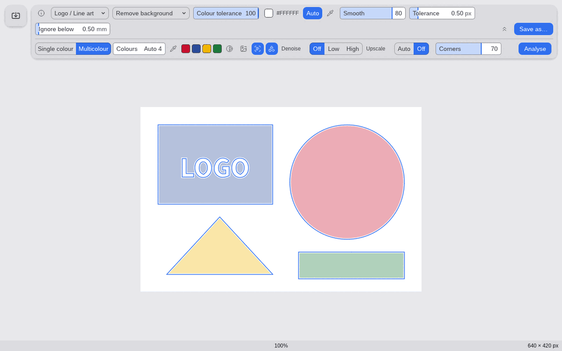
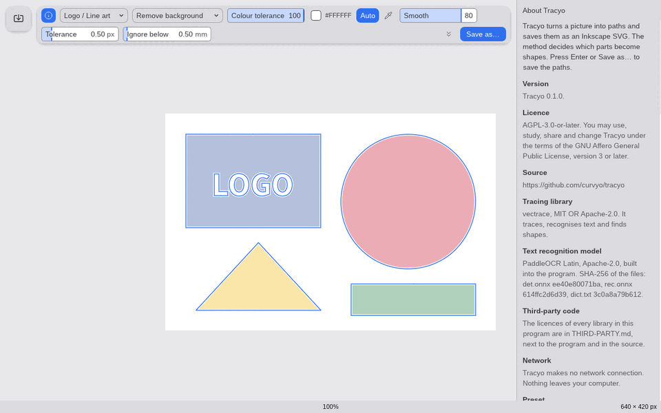

# Tracyo

A small desktop app that turns a raster image into vector paths: open or drop a PNG, JPEG or
WebP, trace it with [vectrace](https://github.com/curvyo/vectrace), save the result as an
Inkscape SVG. It has the Trace tool of [Curvyo](https://github.com/curvyo/curvyo) and nothing
else, and looks like it. Written in Rust with egui. It makes no network connection.



## Install

Download the archive for your system from the
[releases page](https://github.com/curvyo/tracyo/releases), check it against `SHA256SUMS`, unpack
it and start `tracyo` (`tracyo.exe` on Windows). The builds are not signed, so Windows and macOS
ask once before they run it:

- **Windows:** SmartScreen says "Windows protected your PC": click "More info", then "Run anyway".
- **macOS:** remove the download mark once, in a Terminal in the unpacked folder:
  `xattr -dr com.apple.quarantine tracyo`, then `./tracyo`. Use the `aarch64` archive on Apple
  silicon, the `x86_64` one on an Intel Mac.
- **Linux (x86_64, glibc 2.35 or newer):** `./tracyo`. The window needs X11 or XWayland (so that
  dropping files works) and the file dialogs need `xdg-desktop-portal` with a backend, for example
  `xdg-desktop-portal-gtk`. Without one the dialogs do not open and the app says so; give the
  picture on the command line or drop it on the window instead.

## Use

```text
tracyo                 # empty window, then Ctrl+O or drop a picture on it
tracyo picture.png     # open a picture at start
```

- **Open:** the card at the top left, Ctrl+O, a dropped file, or the first command-line argument.
- **Look:** the picture is veiled and the outline the tracer makes is drawn over it in blue. Every
  value of the bar changes it as you drag it. Preset sets Smooth, Tolerance, Ignore below,
  Corners, Upscale and Denoise together; Method is Brightness (Threshold), Remove background or
  Pick colours; the expander opens Output (Single colour or Multicolour with its palette), the
  Invert, Drop border shapes, Recognise text and Recognise shapes toggles, Denoise, Upscale,
  Corners and Analyse. The "i" button opens About: what every value does, the licences, the source.
- **Pan and zoom:** scroll or middle-drag or Space+drag pans, Ctrl+scroll zooms at the pointer,
  Ctrl+0 fits.
- **Stop:** Esc or the x in the blue button; Retry traces again.
- **Save:** the blue button, Enter, Ctrl+S or Ctrl+Shift+S writes an Inkscape SVG in millimetres,
  one layer per colour; recognised text is text and recognised shapes are rectangles, circles and
  ellipses Inkscape can edit.



Your values are kept in `settings.toml` in the per-user config folder (`~/.config/tracyo/` on
Linux, `%APPDATA%\tracyo\` on Windows, `~/Library/Application Support/tracyo/` on macOS).

## Build from source

Rust 1.99 (pinned in `rust-toolchain.toml`; the oldest that builds is the `rust-version` of
`Cargo.toml`) and, on Linux, nothing else to build: the window system libraries are loaded when
the program starts.

```text
cargo build --release     # target/release/tracyo, about 30 MB with the text recognition model
cargo nextest run --workspace
python3 scripts/third-party.py    # rewrites THIRD-PARTY.md after a dependency change
```

The kittest and pixel tests render with wgpu; without a GPU install Mesa's software Vulkan
(`mesa-vulkan-drivers libegl1`) and, for the start test, `xvfb`. The trace runs in a second
process, the same executable started as `tracyo --trace-worker`, so Stop ends it at once. Design
decisions are in `docs/adr/`, the feature in `specs/`, known shortcuts in
`docs/technical-debt.md`, changes in `CHANGELOG.md`. A release is a tag `v<version>`; see
`.github/workflows/release.yml`.

## Licence

AGPL-3.0-or-later (see `LICENSE`). The libraries it links are listed with their licences in
`THIRD-PARTY.md`; the bundled Liberation Sans (SIL OFL 1.1), lucide icons (ISC) and PaddleOCR
Latin model (Apache-2.0) are described in `assets/ASSETS.md`. Source:
https://github.com/curvyo/tracyo
